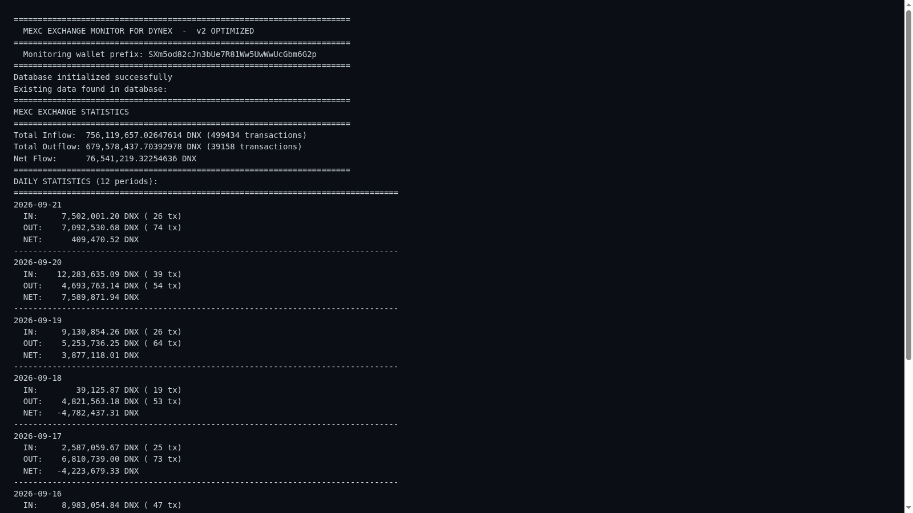

# DNX MEXC In/Out Monitor

Exchange-related movements can be hard to follow when transaction activity is mixed with everything else on the chain. DNX MEXC In/Out Monitor focuses attention on Dynex transfers associated with MEXC, giving the operator a dedicated view of incoming and outgoing activity.

## Tech stack

| Layer | Technologies |
|---|---|
| Application | Python |
| Supporting technologies | Dynex JSON-RPC; SQLite |

## Follow exchange-related movements

The monitor distinguishes the direction of relevant transfers and keeps identifying transaction information close to the event. This helps the operator see what arrived or left without manually scanning unrelated activity. The view is intended for observation and investigation.

## Keep a readable live view

A terminal presentation makes the monitor useful during a running session. New observations appear in context, allowing the operator to follow changes without repeatedly opening individual records. It is a compact tool for checking a specific flow.

## Review activity over time

Recorded observations support returning to earlier activity rather than relying only on the latest screen. Transaction references help connect the monitor's view with a more detailed check when necessary. History adds context to a movement that initially appears unusual.

## Use the view for focused checks

The product's value is its narrow scope: keep attention on the exchange flow being watched. The current screenshot demonstrates that terminal experience. Additional presentation material should be driven by meaningful user workflows rather than collecting images for their own sake.

---

Private code: [dnx-mexc-in-out](https://github.com/logicencoder/dnx-mexc-in-out)

See [REPOS.md](REPOS.md) for related repositories.

**[Logic Encoder](https://logicencoder.com)** · [GitHub](https://github.com/logicencoder) · [Contact](https://logicencoder.com/contact/)
