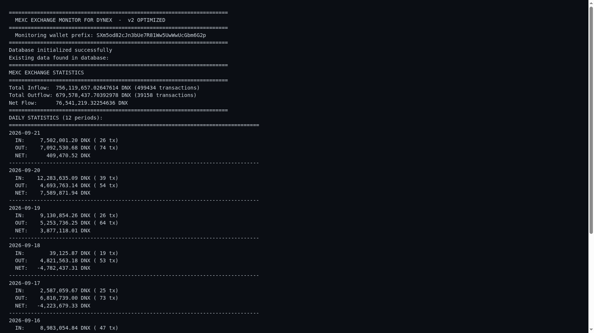

# DNX MEXC In/Out Monitor

Exchange-related movements can be hard to follow when transaction activity is mixed with everything else on the chain. DNX MEXC In/Out Monitor focuses attention on Dynex transfers associated with MEXC, giving the operator a dedicated view of incoming and outgoing activity.

## Tech stack

| Layer | Technologies |
|---|---|
| Application | Python |
| Supporting technologies | Dynex JSON-RPC; SQLite |

## Follow exchange-related movements

The monitor reads blocks from the operator's own Dynex node, picks out transfers to or from addresses carrying the MEXC prefix, marks each as incoming or outgoing and keeps its transaction reference. Every matching transaction is stored; a display threshold (in DNX) only filters what the terminal prints.

Direction is the first useful distinction when reviewing an exchange-related movement. The focused feed keeps that distinction and its transaction reference together for a closer check.

## Keep a readable live view

Started without options it opens an interactive menu; with `--realtime` it only follows new blocks, and the default service mode catches up on missed blocks first and then continues live. Blocks are fetched in parallel, and a checkpoint plus a table of scanned blocks means a restart never rescans what is already known.

The terminal view suits a session where the operator wants to watch incoming observations as they arrive. It keeps the flow readable without requiring a full trading dashboard.

## Review activity over time

History is scanned on demand: the last N blocks (`--scan-last`), from a given height (`--scan-from`) or an inclusive range (`--scan-range`). `--stats hourly`, `daily` or `weekly` prints aggregated incoming and outgoing totals from the stored transactions, and `--rebuild-stats` recomputes those totals if they need to be regenerated.

Returning to earlier observations helps compare a new movement with the activity already seen. The transaction reference provides a route from the summary to a more specific investigation.

## Use the view for focused checks

The same data can be pushed to a WordPress dashboard by a small bridge, which is what feeds the public MEXC balance monitor; the monitor itself is an operator tool with no web interface.

The monitor complements broader chain and market tools by answering one question clearly: which relevant DNX movements are entering or leaving the exchange context being followed?

---

Private code: [dnx-mexc-in-out](https://github.com/logicencoder/dnx-mexc-in-out)

See [REPOS.md](REPOS.md) for related repositories.

**[Logic Encoder](https://logicencoder.com)** · [GitHub](https://github.com/logicencoder) · [Contact](https://logicencoder.com/contact/)
